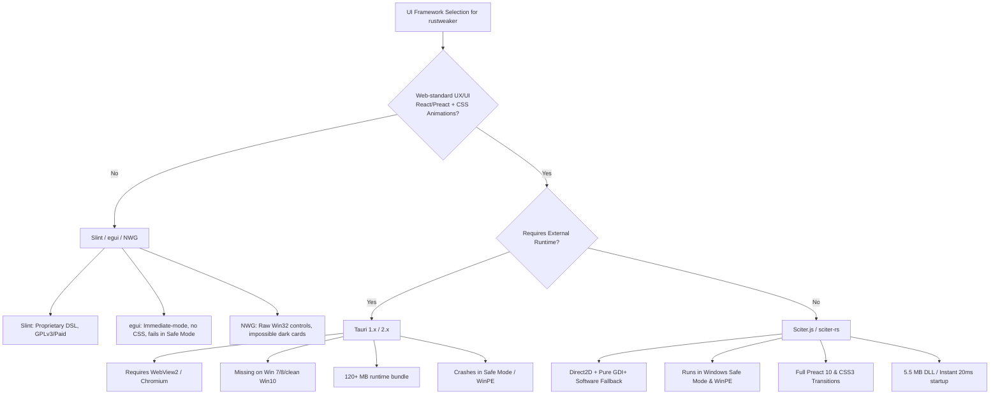
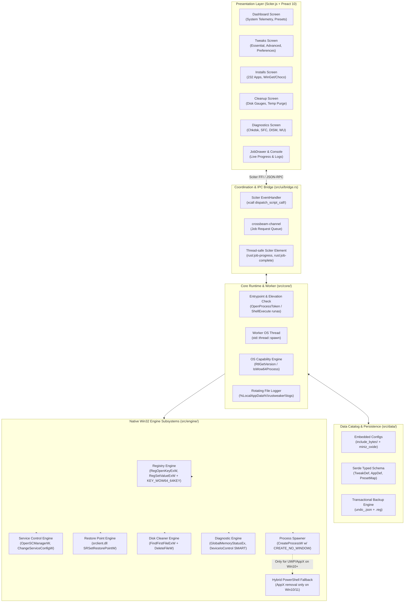

> **Project status (2026-10-27):** This document describes a proposed system, not a released or verified implementation. A minimal Rust skeleton and standalone UI preview exist; the application is not implemented. Validate technical claims and catalog entries against source and tests before implementation. See [AGENT_START.md](AGENT_START.md).


# Architecture Specification: rustweaker

> **Executive Blueprint for the Native Rust Rewrite of Chris Titus Tech's Windows Utility (WinUtil)**  
> Engineered for professional computer repair technicians (*compmaster* workflow).  
> Universal single-file portable binary running on **Windows 7 SP1, 8.1, 10, and 11 (x32 and x64)** with zero external dependencies.

---

## 1. Executive Summary & Problem Statement

The reference codebase (`winutil-26.08.19/`) is a monolithic PowerShell utility wrapped in a WPF (XAML) user interface, compiled via `Compile.ps1` into a single root script `winutil.ps1`. While feature-rich, in real-world computer servicing it suffers from fatal operational limitations:

1. **Catastrophic Cold Startup Latency**: Requires 3–8 seconds simply to initialize the PowerShell Single-Threaded Apartment (STA) runspace pool and parse WPF XAML markup.
2. **Total Incompatibility with Legacy Windows**: Completely fails on fresh Windows 7 SP1 and Windows 8.1 installations where Windows Management Framework (WMF) 5.1 and compatible .NET Framework runtimes are missing.
3. **Execution Policy & WMI Fragility**: Fails on locked client systems with restricted PowerShell execution policies; relies heavily on Windows Management Instrumentation (WMI) repositories that are frequently corrupted on malware-infected or failing machines.
4. **Environment Restrictions**: Cannot run inside **Windows Safe Mode** (where WPF and GPU drivers fail to initialize) or **WinPE** recovery disks.
5. **SmartScreen & Packaging**: Cannot be cryptographically signed as a single standalone executable to build Microsoft SmartScreen reputation.

**rustweaker** completely solves this by replacing PowerShell with a high-performance native **Rust** engine linked statically against the C Runtime (`+crt-static`), directly calling Win32 kernel APIs (`advapi32.dll`, `kernel32.dll`, `ntdll.dll`), and presenting a modern, dark-themed UI via **Sciter.js** running on GDI+/Direct2D without Chromium or WebView2.

---

## 2. Technology Stack & Crate Pins

| Architectural Layer | Technology / Crate | Version Pin | Architectural Justification & Win7 Compatibility |
|:---|:---|:---|:---|
| **Core Language** | **Rust** (Edition 2021) | `1.97.0` (Nightly w/ `-Z build-std`) or `1.77.2` LTS | Zero-runtime memory safety, deterministic RAII handle cleanup (`Drop`), tiny memory footprint (<15 MB RAM). |
| **Target Triples** | `i686-win7-windows-msvc`<br/>`x86_64-win7-windows-msvc` | Tier 3 Windows 7 Targets | **Critical**: Compiles `libstd` with SRWLock/keyed-events instead of Win8+ `WaitOnAddress`, preventing startup crash on Win7 SP1. |
| **CRT Linkage** | `+crt-static` (MSVC `/MT`) | Built-in | Eliminates dependency on Visual C++ Redistributable (`vcruntime140.dll`). |
| **UI Framework** | **Sciter.js** (`sciter-rs`) | `0.5.58` (dynamic API loader) | Embeds HTML5/CSS3/ES6+ QuickJS runtime (~5.5 MB DLL); renders via Direct2D with automatic GDI+ fallback in Safe Mode. |
| **UI Frontend** | **Preact 10.x** + TypeScript | `10.25.x` | Modern reactive component architecture, JSX ergonomics, zero-overhead DOM updates bundled via `esbuild`. |
| **Win32 Bindings** | `windows-sys` | `0.59.0` | Zero-overhead raw C extern declarations (`Advapi32`, `Kernel32`, `Ntdll`, `Shell32`, `Iphlpapi`). Rapid compilation. |
| **Data Compression** | `miniz_oxide` | `0.8.x` | Pure Rust DEFLATE decompression (<25 KB binary impact) for embedded JSON configs (`include_bytes!`). |
| **JSON Serialization** | `serde` + `serde_json` | `1.0.x` | Strongly typed configuration deserialization without AVX2 CPU requirements. |
| **Concurrency** | `std::thread` + `crossbeam-channel` | `0.5.x` | Dedicated background worker OS thread with MPMC job queue. Zero `tokio` async bloat (~800 KB saved). |
| **Error Handling** | `thiserror` + `anyhow` | `2.0.x` / `1.0.x` | `thiserror` for typed Win32 error enums in engine; `anyhow` for top-level CLI and Sciter IPC results. |
| **Logging** | `log` + custom file sink | `0.4.x` | Minimal overhead logging to `%LocalAppData%\rustweaker\logs\`; mirrors WinUtil's `Write-WinUtilLog`. |
| **Process Spawning** | Raw `CreateProcessW` | `windows-sys` | Uses `CREATE_NO_WINDOW (0x08000000)` and anonymous pipes to guarantee zero console window flashing. |
| **Safety Engine** | `srclient.dll` (`SRSetRestorePointW`) | Dynamic `GetProcAddress` | Automatically creates System Restore points; bypasses 24h throttling; falls back gracefully if disabled. |

---

## 3. Stack Verification & Critical ABI Findings

During deep research, three critical architectural assumptions were verified and corrected:

### 3.1 The Rust 1.78+ `WaitOnAddress` Barrier on Windows 7
* **Finding**: Prior to Rust 1.78.0, standard `*-pc-windows-msvc` targets supported Windows 7. In Rust 1.78+, `std::sync::Mutex` switched to Windows 8+ futex kernel primitives (`WaitOnAddress`, `WakeByAddressSingle` in `api-ms-win-core-synch-l1-2-0.dll`). Executables built with standard targets crash before `main()` on Windows 7 SP1.
* **Remediation**: The build pipeline must target the dedicated Tier 3 targets:
  ```bash
  cargo +nightly build --target i686-win7-windows-msvc -Z build-std=std,panic_abort --release
  cargo +nightly build --target x86_64-win7-windows-msvc -Z build-std=std,panic_abort --release
  ```
  Alternatively, the build can use the pinned Rust 1.77.2 toolchain.

### 3.2 Nonexistent `windows7-compat` Crate
* **Finding**: No standalone `windows7-compat` crate exists on crates.io. It was an internal feature flag in older Tauri versions (deprecated in Tauri 2.12).
* **Remediation**: Windows 7 ABI compatibility is enforced via `-win7-windows-msvc` target definitions, `NTDDI_WIN7 (0x06010000)` constants, and dynamic runtime symbol resolution (`LoadLibraryExW` + `GetProcAddress`) for optional APIs.

### 3.3 Sciter.js Licensing & Single-File Portable Executable
* **Finding**: Terra Informatica's Free Sciter license allows free commercial and open-source redistribution of `32/sciter.dll` and `64/sciter.dll` **only as unmodified dynamically linked binaries**. Static linking into a monolithic executable requires an Indie license ($620).
* **Remediation**: Under the Free tier, `rustweaker.exe` embeds `sciter.dll` via `include_bytes!`, extracts it on first run to `%TEMP%\rustweaker\sciter.dll`, and loads it dynamically via `sciter::set_options`. For users with an Indie license, static linkage can be enabled via a Cargo feature flag (`--features static-sciter`).

### 3.4 32-bit WoW64 Registry Redirection on 64-bit Windows
* **Finding**: When a 32-bit (`i686`) binary runs on 64-bit Windows, the WoW64 subsystem redirects `HKLM\SOFTWARE` calls to `HKLM\SOFTWARE\Wow6432Node`, breaking 64-bit system tweaks.
* **Remediation**: All registry operations in `src/engine/registry.rs` pass `KEY_WOW64_64KEY (0x0100)` whenever `IsWow64Process` detects a 64-bit host OS.

---

## 4. UI Framework Evaluation: Why Sciter.js Wins



---

## 5. Layered System Architecture



---

## 6. Engine Subsystem Specifications

### 6.1 Registry Engine (`src/engine/registry.rs`)
- Uses direct `advapi32.dll` exports.
- **Access Mask Discipline**: Avoids `KEY_ALL_ACCESS (0xF003F)` which fails with `ERROR_ACCESS_DENIED (5)` on locked keys. Uses `KEY_QUERY_VALUE | KEY_WOW64_64KEY (0x0101)` for reads and `KEY_SET_VALUE | KEY_CREATE_SUB_KEY | KEY_WOW64_64KEY (0x0106)` for writes.
- **Idempotence**: Treats `ERROR_FILE_NOT_FOUND (2)` as a successful deletion during `RegDeleteValueW`.
- **Pre-mutation Backup**: Queries the existing value and type via `RegQueryValueExW` and persists it to the active `BackupTransaction` before committing changes.

### 6.2 Service Control Engine (`src/engine/services.rs`)
- Opens Service Control Manager (`OpenSCManagerW`) with `SC_MANAGER_CONNECT | SC_MANAGER_ENUMERATE_SERVICE`.
- Opens target service with `SERVICE_QUERY_STATUS | SERVICE_CHANGE_CONFIG | SERVICE_START | SERVICE_STOP`.
- Configures startup state via `ChangeServiceConfigW` (`SERVICE_AUTO_START = 2`, `SERVICE_DEMAND_START = 3`, `SERVICE_DISABLED = 4`).
- Handles `SvcHostSplitThresholdInKB` tuning on modern Windows while cleanly skipping non-existent services on Windows 7.

### 6.3 Restore Point Engine (`src/engine/restore.rs`)
- Loads `srclient.dll` dynamically via `LoadLibraryExW` + `GetProcAddress`. If missing (e.g. WinPE), logs a non-fatal warning and relies on local JSON registry backups.
- Overrides the Windows 8+ 24-hour rate limit by temporarily setting `SystemRestorePointCreationFrequency = 0` (DWORD) under `HKLM\SOFTWARE\Microsoft\Windows NT\CurrentVersion\SystemRestore`.
- Calls `SRSetRestorePointW` with `BEGIN_SYSTEM_CHANGE (100)` and `MODIFY_SETTINGS (12)`.

### 6.4 Diagnostics Engine (`src/engine/diagnostics.rs`)
- **Zero WMI Policy**: Completely avoids slow and fragile WMI queries.
- **Exact OS Detection**: Uses `ntdll.dll!RtlGetVersion` to bypass `GetVersionExW` compatibility shims on Windows 8.1, 10, and 11.
- **Memory & Uptime**: Uses `kernel32.dll!GlobalMemoryStatusEx` and `GetTickCount64` (with `GetTickCount` fallback on 32-bit Win7).
- **Storage SMART Telemetry**: Opens `\\.\PhysicalDrive0` via `CreateFileW` with `dwDesiredAccess = 0` (query access only) and issues `IOCTL_STORAGE_QUERY_PROPERTY (0x002D1400)` to detect drive model, bus type (NVMe, SATA, USB), and SSD seek-penalty status.

### 6.5 Disk Cleaner Engine (`src/engine/cleaner.rs`)
- Uses `kernel32.dll!GetDiskFreeSpaceExW` to calculate free bytes before and after execution.
- Traverses `%TEMP%`, `C:\Windows\Temp`, `C:\Windows\Prefetch`, and `SoftwareDistribution\Download` using `FindFirstFileExW` with `FindExInfoBasic` and `FIND_FIRST_EX_LARGE_FETCH (2)`.
- Automatically strips `FILE_ATTRIBUTE_READONLY` before calling `DeleteFileW`.
- Silently catches and ignores `ERROR_SHARING_VIOLATION (32)` and `ERROR_ACCESS_DENIED (5)` on active locked in-use files.

---

## 7. Build Matrix & Packaging

| Binary Name | Target Triple | Target Architectures | Linker Flags & Defines |
|:---|:---|:---|:---|
| `rustweaker-x86.exe` | `i686-win7-windows-msvc` | 32-bit Windows 7–10;<br/>64-bit Windows 7–11 (via WoW64) | `-C target-feature=+crt-static`<br/>`/SUBSYSTEM:WINDOWS,6.01`<br/>`-Z build-std=std,panic_abort` |
| `rustweaker-x64.exe` | `x86_64-win7-windows-msvc` | 64-bit Windows 7 SP1, 8.1, 10, 11 | `-C target-feature=+crt-static`<br/>`/SUBSYSTEM:WINDOWS,6.01`<br/>`-Z build-std=std,panic_abort` |

### Graceful Degradation Strategy
When `RtlGetVersion` reports Windows 7 (`6.1`) or Windows 8.1 (`6.3`):
1. **UWP/AppX Screen**: Displays an informational badge ("Not applicable on this Windows version") and disables package removal buttons.
2. **Package Manager**: Automatically switches default installation engine from WinGet to Chocolatey (`choco.exe`) or direct WinHTTP downloads.
3. **OS-Exclusive Tweaks**: Tweaks marked `Win10+` or `Win11` in `TWEAKS_INVENTORY.md` are tagged with warning badges and safely omitted during batch execution.
4. **Ultimate Performance**: Duplicates the Ultimate Performance power scheme GUID on Win10/11, or falls back to High Performance (`8c5e7fda-...`) on Win7.
