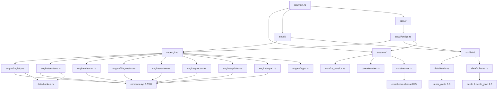
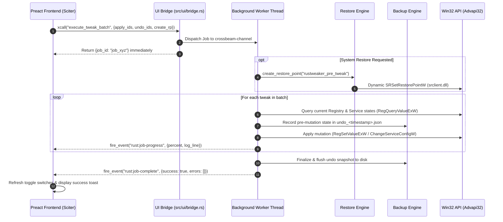

> **Project status (2026-10-27):** This document describes a proposed system, not a released or verified implementation. A minimal Rust skeleton and standalone UI preview exist; the application is not implemented. Validate technical claims and catalog entries against source and tests before implementation. See [AGENT_START.md](AGENT_START.md).


# Codebase Map: rustweaker

> **Ground-truth module boundaries, file dependencies, data flow pipelines, and development constraints.**  
> Cross-links: [ARCHITECTURE.md](file:///d:/pen1s/projects/tweaker/ARCHITECTURE.md) | [AGENTS.md](file:///d:/pen1s/projects/tweaker/AGENTS.md) | [TWEAKS_INVENTORY.md](file:///d:/pen1s/projects/tweaker/TWEAKS_INVENTORY.md)

---

## 1. Planned Repository Layout

```text
d:\pen1s\projects\tweaker\
├── Cargo.toml                       # Root Cargo manifest & release profile
├── build.rs                         # Compresses JSON configs & packages UI assets
├── .cargo\
│   └── config.toml                  # +crt-static flags & /SUBSYSTEM:WINDOWS,6.01 link arguments
├── src\
│   ├── main.rs                      # Application bootstrap, CLI routing & UI window entry
│   ├── core\
│   │   ├── mod.rs                   # Core module exports
│   │   ├── elevation.rs             # UAC token elevation check & re-launch with runas
│   │   ├── os_version.rs            # RtlGetVersion kernel detection & capability flags
│   │   ├── wow64.rs                 # IsWow64Process detection & 64-bit flag injectors
│   │   ├── worker.rs                # Background OS thread pool & crossbeam job queue
│   │   └── logger.rs                # Rotating file logger (%LocalAppData%\rustweaker\logs)
│   ├── data\
│   │   ├── mod.rs                   # Data module exports
│   │   ├── schema.rs                # Strongly typed serde models (TweakDef, AppDef, PresetMap)
│   │   ├── loader.rs                # Compile-time include_bytes! & miniz_oxide decompression
│   │   └── backup.rs                # Transactional rollback storage (.json snapshot + .reg export)
│   ├── engine\
│   │   ├── mod.rs                   # Subsystem orchestration & backend traits
│   │   ├── registry.rs              # Win32 Advapi32 registry operations + WOW64 handling
│   │   ├── services.rs              # Win32 SCM service queries & ChangeServiceConfigW
│   │   ├── restore.rs               # Dynamic srclient.dll SRSetRestorePointW caller
│   │   ├── cleaner.rs               # Win32 FindFirstFileExW recursive disk cleanup
│   │   ├── diagnostics.rs           # Zero-WMI RAM, CPU & SMART disk telemetry
│   │   ├── process.rs               # CreateProcessW with CREATE_NO_WINDOW & pipe redirection
│   │   ├── updates.rs               # Windows Update policy configurations & cache purge
│   │   ├── repair.rs                # System repair coordinator (Chkdsk, SFC, DISM)
│   │   ├── appx.rs                  # Hybrid PowerShell bridge for Windows 10/11 UWP removal
│   │   ├── network.rs               # Winsock reset & DNS configuration via netsh
│   │   ├── power.rs                 # Power scheme duplication & activation (Ultimate/High Perf)
│   │   └── shell.rs                 # IShellLinkW shortcut creator & Control Panel applet launcher
│   ├── ui\
│   │   ├── mod.rs                   # Sciter window initialization & event loop
│   │   ├── bridge.rs                # Sciter EventHandler implementation & xcall dispatcher
│   │   └── archive.rs               # Custom HostHandler serving embedded this://app/ assets
│   └── cli\
│       ├── mod.rs                   # Headless CLI argument parser & execution router
│       └── impex.rs                 # Custom JSON preset import/export engine
├── ui\                              # Preact 10 + TypeScript frontend source
│   ├── package.json                 # UI dependencies (preact, typescript, esbuild)
│   ├── esbuild.config.mjs           # Bundler config targeting ES2020 IIFE
│   ├── src\
│   │   ├── App.tsx                  # Root component, routing, global state provider
│   │   ├── types\sciter.d.ts        # Sciter.js global definitions (Window.this)
│   │   ├── store\
│   │   │   ├── state.ts             # Reactive stores (active tweaks, system telemetry)
│   │   │   └── selection.ts         # Checkbox selection counters & filter badges
│   │   ├── components\
│   │   │   ├── Sidebar.tsx          # 220px fixed left navigation rail
│   │   │   ├── Header.tsx           # Window controls, search input, preset buttons
│   │   │   ├── TweakCard.tsx        # Card widget with animated toggle switch & badges
│   │   │   ├── AppTile.tsx          # Software installer tile with package manager badge
│   │   │   ├── JobDrawer.tsx        # Bottom slide-up panel with live logs & progress bar
│   │   │   └── Toast.tsx            # Animated notification container
│   │   ├── screens\
│   │   │   ├── Dashboard.tsx        # System overview, quick diagnostics & preset triggers
│   │   │   ├── Tweaks.tsx           # Categorized tweak grids (Essential, Advanced, Prefs)
│   │   │   ├── Installs.tsx         # 232 apps catalog with category filters & search
│   │   │   ├── Cleanup.tsx          # Disk space cleanup gauges & target selectors
│   │   │   ├── Diagnostics.tsx      # System repair actions (SFC, DISM, Network, WU)
│   │   │   └── Settings.tsx         # Preset import/export, manual restore point & logs
│   │   └── styles\
│   │       ├── tokens.css           # High-contrast dark theme variables (#0d0d0d)
│   │       ├── animations.css       # Hardware/software-safe CSS transitions & keyframes
│   │       └── global.css           # Reset styles, typography & utility classes
│   └── dist\                        # Output directory bundled into Rust binary
│       ├── bundle.js                # Compiled Preact application
│       └── styles.css               # Compiled styles
├── winutil-26.08.19\                # READ-ONLY reference directory (original PowerShell source)
└── .agents\                         # AI Agent configuration, skills & memory
```

---

## 2. Module Dependency Graph



---

## 3. End-to-End Tweak Execution & Rollback Pipeline

Every tweak batch follows a strict five-stage transactional lifecycle:



---

## 4. Application Catalog Verification (`config/applications.json`)

The application catalog defines **232 applications** across 10 categories. Because WinGet requires Windows 10 1709+, `rustweaker` uses a dual-engine architecture:

| Category | Total Apps | WinGet Support (Win10 1709+ / Win11) | Chocolatey Support (Win7 SP1 – Win11) | Core Examples from Catalog |
|:---|:---:|:---:|:---:|:---|
| **Browsers** | 19 | 100% | 100% | Brave, Firefox, Chrome, Thorium, LibreWolf, Zen Browser, Edge |
| **Communications** | 18 | 100% | 94% | Discord, Telegram, Signal, Thunderbird, Slack, Teams, Zoom |
| **Development** | 38 | 100% | 95% | VS Code, Git, Rustup, Python 3, Node.js, Neovim, Docker Desktop |
| **Document** | 21 | 100% | 95% | Obsidian, LibreOffice, SumatraPDF, Notepad++, PDFgear, Okular |
| **Games** | 16 | 100% | 88% | Steam, GOG Galaxy, Heroic Launcher, Playnite, Prism Launcher |
| **Microsoft Tools** | 22 | 95% | 91% | VC++ 2015–2022 Redist, .NET Desktop Runtimes, PowerToys, Sysinternals |
| **Multimedia** | 28 | 100% | 96% | VLC, MPV, OBS Studio, HandBrake, Audacity, GIMP, Krita, Paint.NET |
| **Pro Tools** | 19 | 100% | 89% | Wireshark, Nmap, PuTTY, WinSCP, Rufus, Ventoy, MiniTool Partition |
| **Utilities** | 45 | 98% | 93% | 7-Zip, Everything, ShareX, WizTree, Deskflow, YASB, 1Password |
| **AI-Automation** | 6 | 100% | 67% | Ollama, LM Studio, Jan, ComfyUI, OpenWebUI |
| **Total** | **232** | **~99%** | **~93%** | *Automatic fallback to Chocolatey on Windows 7/8.1* |

---

## 5. Critical Development Invariants & Constraints

AI coding agents working in this repository must strictly adhere to the following non-negotiable rules:

1. **Zero WMI Policy**: Never use `wbemdisp.dll`, `wmi` crates, or PowerShell WMI cmdlets. WMI repositories are frequently broken on repair PCs. Use `ntdll!RtlGetVersion`, `kernel32!GlobalMemoryStatusEx`, and `DeviceIoControl` with `IOCTL_STORAGE_QUERY_PROPERTY`.
2. **Zero PowerShell for Core Operations**: Never invoke `powershell.exe` for registry, service, filesystem, or network changes. PowerShell is reserved exclusively as a hybrid fallback for Windows 10/11 UWP AppX package removal.
3. **Mandatory 64-bit Registry Flags**: On 64-bit Windows, always pass `KEY_WOW64_64KEY (0x0100)` in `RegOpenKeyExW`, `RegCreateKeyExW`, and `RegDeleteKeyExW` to bypass 32-bit WoW64 registry redirection.
4. **Pointer Safety in `windows-sys 0.59.0`**:
   - `HANDLE` and `HKEY` are raw pointers (`*mut core::ffi::c_void`), NOT integers (`isize`).
   - Initialize with `std::ptr::null_mut()`.
   - Validate with `!h.is_null() && h != INVALID_HANDLE_VALUE`.
   - Always wrap in an RAII struct implementing `Drop` (`CloseHandle`, `RegCloseKey`, `CloseServiceHandle`).
   - Cast handles to `usize` when transferring across thread boundaries.
5. **Transactional Pre-mutation Backup**: No registry key or service state may be modified without first saving the current value to the active `BackupTransaction`.

---

## 6. Testing & Quality Verification Strategy

To guarantee Windows 7 SP1 compatibility without requiring physical hardware runners for every unit test:

* **Backend Abstraction**: `RegistryBackend` and `ServiceBackend` traits in `src/engine/` allow running unit tests against in-memory mock structures (`InMemoryRegistry`, `InMemoryScm`).
* **Test Coverage**: Validate forward execution and 100% undo restoration across all 66 tweaks in `cargo test --lib`.
* **Binary Import Audit**: Post-build CI verification using `llvm-objdump -p` ensures that the compiled PE executable contains **zero forbidden imports**:
  - `WaitOnAddress` / `WakeByAddressSingle` (forbidden on Win7)
  - `CreateFile2` (forbidden on Win7)
  - `SetThreadDescription` (forbidden on Win7)
  - Static link to `srclient.dll` (must be dynamic)
