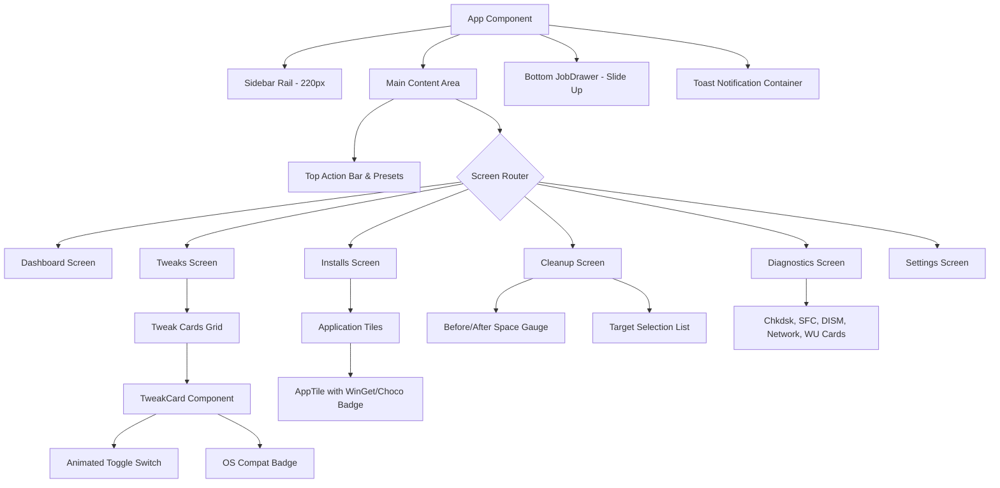

> **Project status (2026-10-27):** This document describes a proposed system, not a released or verified implementation. A minimal Rust skeleton and standalone UI preview exist; the application is not implemented. Validate technical claims and catalog entries against source and tests before implementation. See [AGENT_START.md](AGENT_START.md).


# UI Specification: rustweaker

> **Modern Dark-Themed Desktop Interface for Professional Technicians.**  
> Built with **Preact 10.x** and hardware/software-accelerated **CSS3** inside **Sciter.js**.  
> Cross-links: [ARCHITECTURE.md](file:///d:/pen1s/projects/tweaker/ARCHITECTURE.md) | [CODEBASE.md](file:///d:/pen1s/projects/tweaker/CODEBASE.md)

---

## 1. Visual Design Language & Design Tokens

`rustweaker` rejects the outdated, gray Win32 dialog aesthetic in favor of a modern, high-contrast dark theme optimized for long hours in computer repair shops and high-DPI displays.

### CSS Custom Properties (`ui/src/styles/tokens.css`)

```css
:root {
  /* Surface Color Palette */
  --bg-canvas:        #0d0d0d; /* Root window background */
  --bg-surface-1:     #141417; /* Sidebar, header, sticky preset bar */
  --bg-surface-2:     #1c1c21; /* Cards, tiles, diagnostic panels */
  --bg-surface-hover: #25252d; /* Hovered cards, clickable items */
  --bg-surface-active:#2d2d38; /* Pressed controls, active state */

  /* Borders & Dividers */
  --border-subtle:    #22222a;
  --border-strong:    #32323d;
  --border-focus:     #3b82f6;

  /* Accent & State Colors */
  --accent-primary:   #3b82f6; /* Blue: Active switches, primary actions */
  --accent-primary-hover: #2563eb;
  --accent-warning:   #f59e0b; /* Amber: Caution tweaks, confirmation dialogs */
  --accent-danger:    #ef4444; /* Red: Destructive actions, errors */
  --accent-success:   #10b981; /* Green: Active services, freed space */

  /* Text Hierarchy */
  --text-primary:     #f4f4f5; /* Primary headings, body copy */
  --text-secondary:   #a1a1aa; /* Descriptions, labels, metadata */
  --text-muted:       #71717a; /* Disabled text, subtle hints */

  /* Typography */
  --font-sans:        'Segoe UI', system-ui, -apple-system, sans-serif;
  --font-mono:        'Consolas', 'Cascadia Code', monospace;

  /* Spacing Grid */
  --space-xs:         4px;
  --space-sm:         8px;
  --space-md:         12px;
  --space-lg:         16px;
  --space-xl:         24px;

  /* Border Radii */
  --radius-sm:        4px;
  --radius-md:        8px;
  --radius-lg:        12px;
}
```

---

## 2. Component Hierarchy & Screen Inventory



### Screen Breakdown
1. **Dashboard (`Dashboard.tsx`)**:
   - Host OS version badge (e.g. `Windows 10 Pro 22H2 Build 19045`).
   - Hardware telemetry widget: CPU model, total/used RAM, primary drive model & SMART health status.
   - Quick preset launcher buttons: `Standard`, `Minimal`, `Advanced`.
2. **Tweaks (`Tweaks.tsx`)**:
   - Tabbed/sectioned view: *Essential Tweaks*, *Advanced Tweaks (Caution)*, *Customize Preferences*, *Performance Plans*.
   - Filter bar: Search by keyword, filter by category, filter by OS compatibility.
   - Batch execution footer: "Apply 14 Selected", "Revert Selected".
3. **Installs (`Installs.tsx`)**:
   - 232 applications grouped across 10 collapsible categories.
   - Engine toggle: WinGet vs. Chocolatey (auto-defaults based on OS).
   - "Install Selected" and "Upgrade All" action buttons.
4. **Cleanup (`Cleanup.tsx`)**:
   - Circular disk free space gauge.
   - Checkbox targets: User Temp (`%TEMP%`), System Temp (`C:\Windows\Temp`), Prefetch, SoftwareDistribution Update Cache, Memory Dumps.
   - Real-time calculated disk space savings.
5. **Diagnostics (`Diagnostics.tsx`)**:
   - Action cards with status indicators:
     - System Integrity: SFC `/scannow` + DISM `/RestoreHealth`.
     - Drive Check: Chkdsk `/scan /perf`.
     - Network Stack: Winsock reset + TCP/IP reset + Flush DNS.
     - Windows Update Repair: Flush cache, reset services, re-register DLLs.
6. **Settings (`Settings.tsx`)**:
   - Backup manager: Browse past rollback snapshots, 1-click restore.
   - Preset file import/export (`.json`).
   - View live rotating log files.

---

## 3. Sciter-Safe Animation Specification

To prevent rendering artifacts when running on software GDI+ in Safe Mode or on generic basic display drivers:

### 3.1 Screen Entrance Animation
```css
@keyframes screenFadeIn {
  from {
    opacity: 0;
    transform: translateY(6px);
  }
  to {
    opacity: 1;
    transform: translateY(0);
  }
}

.screen-container {
  animation: screenFadeIn 140ms cubic-bezier(0.16, 1, 0.3, 1) forwards;
}
```

### 3.2 Toggle Switch Thumb Animation
```css
.toggle-switch {
  width: 36px;
  height: 20px;
  background-color: var(--border-strong);
  border-radius: 10px;
  transition: background-color 160ms ease-out;
  cursor: pointer;
}

.toggle-switch[data-checked="true"] {
  background-color: var(--accent-primary);
}

.toggle-thumb {
  width: 16px;
  height: 16px;
  background-color: #ffffff;
  border-radius: 8px;
  transform: translateX(2px);
  transition: transform 160ms cubic-bezier(0.34, 1.56, 0.64, 1);
}

.toggle-switch[data-checked="true"] .toggle-thumb {
  transform: translateX(18px);
}
```

### 3.3 Indeterminate Shimmer Progress Bar
```css
@keyframes shimmer {
  0% { transform: translateX(-100%); }
  100% { transform: translateX(200%); }
}

.progress-shimmer {
  width: 50%;
  height: 100%;
  background: linear-gradient(90deg, transparent, rgba(59, 130, 246, 0.5), transparent);
  animation: shimmer 1.2s infinite linear;
}
```

---

## 4. Sciter.js IPC & Bridge Contract (`src/ui/bridge.rs`)

Communication between Preact (JavaScript) and Rust runs over Sciter's native FFI bridge:

### 4.1 JS → Rust Methods (`Window.this.xcall(method, payload)`)

| Method Name | Payload (JSON) | Return Value (JSON) | Description |
|:---|:---|:---|:---|
| `get_bootstrap_payload` | `{}` | `BootstrapData` | Returns OS version, all tweaks, apps, features, and default presets. |
| `query_tweak_states` | `[tweak_id]` | `{ [id: string]: boolean }` | Checks live registry and service states to set switch positions. |
| `execute_tweak_batch` | `{ apply: string[], revert: string[], create_rp: boolean }` | `{ job_id: string }` | Dispatches batch to background worker; returns immediately. |
| `run_disk_cleaner` | `{ targets: string[] }` | `{ job_id: string }` | Starts asynchronous disk cleanup. |
| `get_diagnostics` | `{}` | `DiagnosticsSnapshot` | Gathers CPU, RAM, and SMART drive health data. |
| `export_preset` | `{ name: string, tweak_ids: string[] }` | `{ path: string }` | Opens Win32 SaveFileDialog and writes JSON preset. |
| `import_preset` | `{}` | `{ name: string, tweak_ids: string[] }` | Opens Win32 OpenFileDialog and parses external preset. |

### 4.2 Rust → JS Custom Events (`document.on(event, handler)`)

| Event Name | Event Data (JSON) | Purpose |
|:---|:---|:---|
| `rust:job-progress` | `{ job_id, step, percent, log_line }` | Updates JobDrawer progress bar and streams live console output. |
| `rust:job-complete` | `{ job_id, success, freed_bytes, errors }` | Closes progress bar, triggers toast, and refreshes UI state. |
| `rust:toast` | `{ type: "info"\|"success"\|"error", message }` | Displays transient floating notification. |

---

## 5. Frontend Build & Asset Embedding Pipeline

```text
Preact JSX/TSX Source (ui/src/)
       │
       ▼ (npm --prefix ui run build)
esbuild --bundle --target=es2020 --format=iife --minify
       │
       ▼
Output Assets:
├── ui/dist/bundle.js (~95 KB minified)
└── ui/dist/styles.css (~18 KB minified)
       │
       ▼ (build.rs / cargo build)
include_bytes! / Sciter HostHandler archive
       │
       ▼
Single Executable (rustweaker.exe)
```
